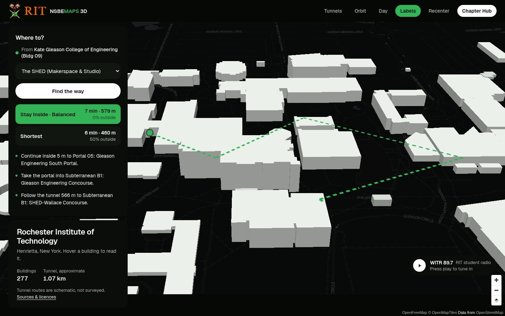
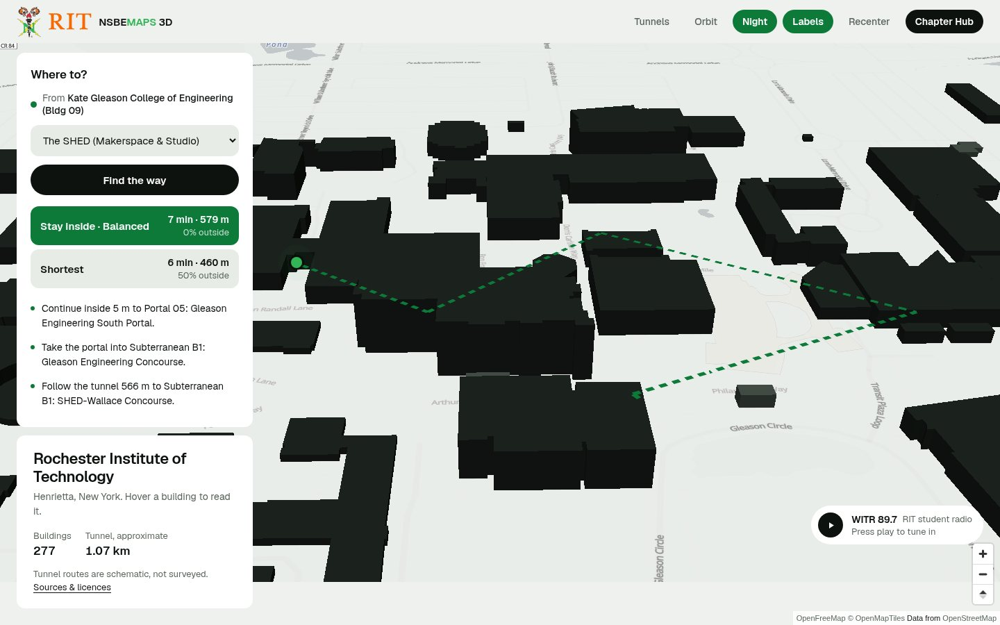
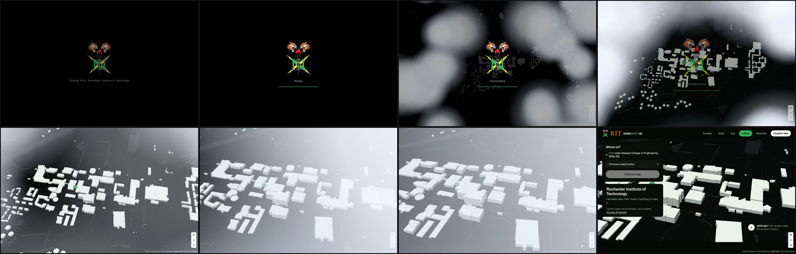
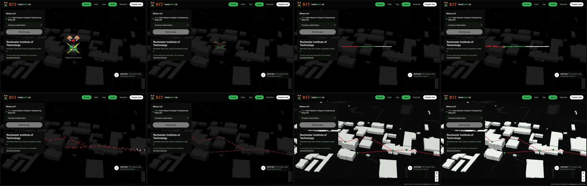

# RIT NSBE Maps

A three-dimensional map of the Rochester Institute of Technology campus that
knows about the tunnels.

**[nsbe-maps.vercel.app](https://nsbe-maps.vercel.app)**

A prototype by NSBE RIT Chapter #103 for Imagine RIT. Not a commercial
project, and not affiliated with the national organisation.



---
## Read this first: what is and is not accurate

**The tunnel layout is a schematic.** It shows which buildings connect to
which, roughly. It is **not** accurate to RIT's current tunnels, it has not
been surveyed, and it has not been checked against RIT's own plans — which are
restricted to RIT accounts. Do not use it to find a door you cannot afford to
miss.

Everything else on the map is drawn from open data, and
[where it comes from](https://nsbe-maps.vercel.app/sources) is written down,
including the three things nobody has confirmed yet.

## Review notes, and what was done about them

The chapter reviewed the site on 2026-11-14 and left these notes here. Their
wording is kept as written; the right-hand column says what happened.

| Note | What was done |
|---|---|
| Doesn’t quite stick to the established theme colors | **Done.** The neon green and pink-red were mine. The palette is now the logo's own green (`#33B457`) and flame red (`#EB2030`). |
| The navigation cuts through buildings -- is that meant to be through the most efficient entrances and exits? | **Partly.** No, it was not deliberate: routes were straight lines between waypoints. Outdoor legs now follow OpenStreetMap footpaths (10 of 16; the other 6 stay straight because the footpath data has gaps there). Indoor and tunnel legs are dashed, because they do go through or under buildings. Real entrances are still unknown. |
| The “inside” button seems the be the only one generating something unique | **Done.** The routes are computed together and grouped when they agree, so there are two honest options instead of three buttons giving two answers. |
| Must change the logo to RIT NSBE or else we will get copyrighted because we aren’t affiliated nationally | **Done.** The site uses the RIT NSBE chapter logo. The national mark was removed from the site and from the repository. It is still in the git history. |
| Where are we sourcing these from? Are any of them copyrighted? Can we use Mendely to keep track of sources | **Done, and it found a real problem.** [`sources.html`](sources.html) lists everything, and [`docs/sources.bib`](docs/sources.bib) and [`docs/sources.ris`](docs/sources.ris) import into Mendeley. Checking turned up Google satellite imagery in the old map and in four pictures; all of it was removed. Still unconfirmed: WITR, the logos, and where the routing graph came from. |
| Tunnels aren’t accurate to current RIT | **Not fixed, and cannot be by code.** Every place the tunnels appear now says they are a schematic. Accuracy needs RIT Facilities Management's agreement, because their plans are restricted. |
| Please explain the “What’s on” Function | It was a panel of clubs and office hours with a button to route to each room. Every club, person and time in it was invented placeholder content. |
| After explanation: Not a necessary | **Removed.** |
| The information on the bottom left overlaps with the directions on how to get there | **Fixed.** The planner and the info card share one column, so they cannot overlap. Measured at four window sizes. |
| Interface on the phones are a bit harder to interact w/ | **Reworked.** Bottom sheet, a menu, every control at least 44 px, the route framed above the sheet. |
| Chapter Hub doesn't make a lot of sense to me -- is it meant to be a compilation of our progress or something more for RIT (if its something more for RIT that is an afterthought) | **Open.** This needs a decision from the chapter. In the meantime the claims on it that nothing supports were removed. |

## Why it exists

RIT has a lot of tunnel under it. In February the difference between the short
way and the warm way is the difference between a pleasant walk and a
miserable one, and no campus map tells you which is which.

This one tries to. Ask it for the SHED from Kate Gleason Hall and it offers
the route that stays entirely under cover, and the shorter one that does not,
side by side.

## What is in it

- **277 buildings** extruded from OpenStreetMap, flat and toy-like, on a dark
  board or a pale one.
- **A routing graph** of 40 waypoints and 49 edges. Every edge is tagged
  outdoor, indoor, tunnel or portal, which is what lets the router answer
  "get me there without going outside". See the warning above.
- **Route options that are honestly different.** It computes inside, balanced
  and shortest, and groups the ones that agree — `Stay inside · Balanced` —
  instead of offering three buttons that give two answers.
- **Outdoor legs on real footpaths** where OpenStreetMap has them: 10 of the 16
  outdoor edges. The other 6 stay straight lines, because the footpath data has
  gaps there and a detour computed across a gap is worse than a straight line.
  Indoor and tunnel legs are dashed: they go through or under buildings, and a
  solid line through a building looks like a mistake when it is not one.
- **Your position** as a green dot that snaps to the nearest waypoint.
- **WITR 89.7**, the student station, streaming live. WITR has not been asked
  about this yet.
- **An arrival sequence** that falls through cloud onto the campus, and a
  tunnel reveal where a line of red, green and white breaks into the network.
- **A phone layout** with a bottom sheet and thumb-sized controls.
- **The Konami code.** Find out yourself.

Day mode inverts the board: black pieces on paper instead of bone on
near-black.



The arrival: a logo on black, then down through three decks of cloud onto the
campus.



Turning the tunnels on: the mark folds into a line, the line breaks apart, and
the pieces fly out to where the tunnel layer is drawn.



## Running it

No build step, no dependencies, no API keys. It is static files.

```bash
git clone https://github.com/ffgamer404-glitch/nsbe-maps.git
cd nsbe-maps
python3 -m http.server 8787
```

Then open <http://localhost:8787/mapa3d.html>.

Geolocation needs a secure context, so the green dot works on `localhost` and
on https, and nowhere else.

## How it is put together

```
mapa3d.html            the 3D map: markup and styles
hub.html               the chapter hub
sources.html           where everything comes from

js/map3d.js            wiring: camera, layers, panels, boot
js/routing.js          Dijkstra over the campus graph, and the route options
js/locator.js          the GPS dot, and the tiger it becomes
js/clouds.js           the three cloud decks you fall through
js/tunnelreveal.js     logo, then line, then particles, then the tunnel layer
js/ritchie.js          the parade balloons

data/                  the campus graph, the buildings, the footpaths
tools/                 fetch and snap the OpenStreetMap data
docs/                  screenshots, and the sources as .bib and .ris
```

Rendering is [MapLibre GL JS](https://maplibre.org/) over
[OpenFreeMap](https://openfreemap.org/) tiles. No account, no key, no bill.

## The data

Read [`data/README.md`](data/README.md) before trusting or redistributing any
of it. The short version: buildings and footpaths are OpenStreetMap under the
ODbL, and the attribution must stay on the map. The routing graph is the
chapter's own and is a schematic. The sources are also in
[`docs/sources.bib`](docs/sources.bib) and [`docs/sources.ris`](docs/sources.ris),
which Mendeley imports directly.

## Contributing

Yes, please. See [CONTRIBUTING.md](CONTRIBUTING.md). What would help most:

| | |
|---|---|
| **Accurate tunnels** | The layout is a schematic. Making it real needs RIT Facilities Management's agreement, because their plans are restricted. It is a conversation, not a scraper. |
| **Where the graph came from** | The origin of the waypoint coordinates is not written down. Someone who knows should write it down. |
| **Tiger Transit** | There is no public GTFS feed we could find, so bus routing is unbuilt. |
| **WITR** | Ask the station whether embedding their stream is fine. |
| **Building interiors** | RIT's floor plans need a login. Same conversation as the tunnels. |

## Licence

Code is [MIT](LICENSE).

The data is not all MIT and the logos are not licensed at all.
[NOTICE.md](NOTICE.md) sets out what applies to what, and
[`data/README.md`](data/README.md) goes file by file.
