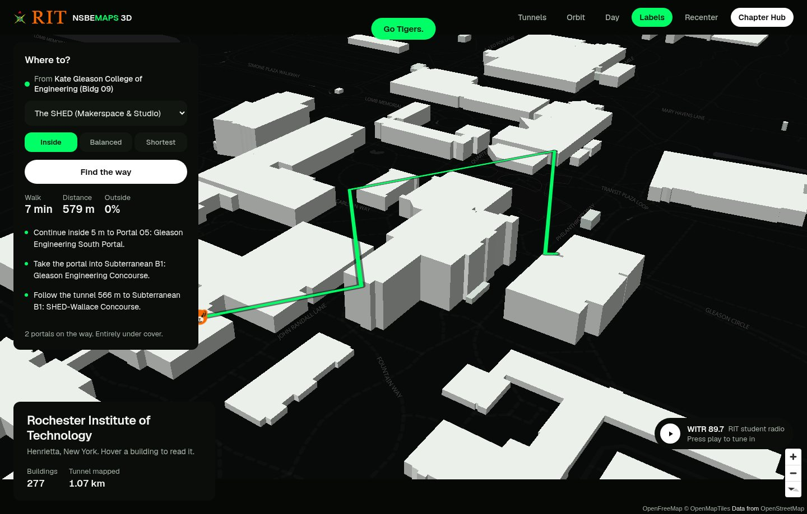
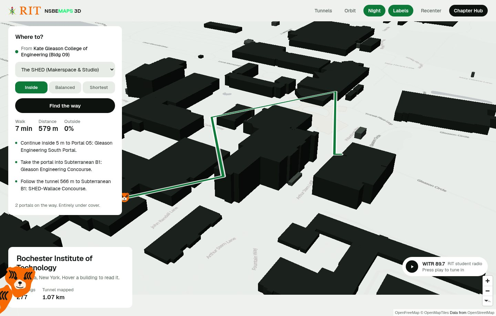
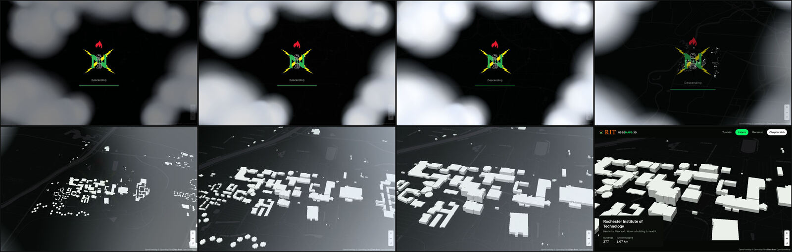
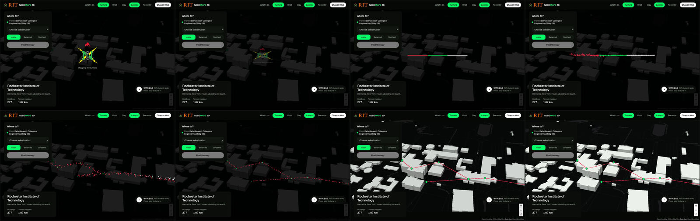

# NSBEMAPS

A three-dimensional map of the Rochester Institute of Technology campus that
knows about the tunnels.

**[nsbe-maps.vercel.app](https://nsbe-maps.vercel.app)**

Built by NSBE RIT Chapter #103 as a prototype for Imagine RIT. Not a
commercial project.



---
## current improvments for the webpage
-FMS building plans
-display floors from top view (flor 1,2,3)
-differentiate buildings using abreviations
-NSBE RIT logo
-Colors for buildings -based on majors


## Why it exists

RIT has about 2.4 km of heated tunnels under it. In February the difference
between the short way and the warm way is the difference between a pleasant
walk and a miserable one, and no campus map tells you which is which.

This one does. Ask it for the SHED from Kate Gleason Hall and it will offer
you 318 m fully exposed, or 579 m entirely under cover, and let you pick.

## What is in it

- **277 buildings** extruded from OpenStreetMap, flat and toy-like, on a dark
  board or a pale one.
- **A routing graph** of 40 nodes and 49 edges, surveyed on foot by students.
  Every edge knows whether it is outdoors, indoors, a tunnel or a portal.
- **Three ways to travel**: shortest, balanced, or inside. Nine of eighteen
  destinations take a genuinely different path when you ask to stay in.
- **Your position** as a green dot that snaps to the nearest graph node.
- **WITR 89.7**, the student station, streaming live.
- **A clubs and office-hours panel** — currently placeholder data, see below.
- **An arrival sequence** that falls through cloud onto the campus, and a
  tunnel reveal where a line of red, green and white shatters into the
  network.
- **The Konami code.** Find out yourself.

Day mode inverts the board — black pieces on paper instead of bone on
near-black:



The arrival: a logo on black, then down through three decks of cloud onto the
campus.



Turning the tunnels on: the mark folds into a line of red, green and white,
the line shatters, and the pieces fly out to exactly where the tunnels are.



## Running it

No build step, no dependencies, no API keys. It is static files.

```bash
git clone https://github.com/<owner>/nsbe-maps.git
cd nsbe-maps
python3 -m http.server 8787
```

Then open <http://localhost:8787/mapa3d.html>.

Geolocation needs a secure context, so the green dot works on `localhost` and
on https, and nowhere else.

## How it is put together

```
mapa3d.html            the 3D map — markup, styles, nothing else
hub.html               the chapter hub: research, downloads, booking
index.html             the original Leaflet 2D map, still working

js/map3d.js            wiring: camera, layers, panels, boot
js/routing.js          Dijkstra over the campus graph, with the profiles
js/locator.js          the GPS dot, and the tiger it becomes
js/campuslife.js       clubs and office hours, sorted by what is next
js/clouds.js           the three cloud decks you fall through
js/tunnelreveal.js     logo → line → particles → tunnel network
js/ritchie.js          the parade balloons

data/                  the campus graph, the buildings, the club list
tools/                 fetch and validate the data
```

Rendering is [MapLibre GL JS](https://maplibre.org/) over
[OpenFreeMap](https://openfreemap.org/) tiles. No account, no key, no bill.

## The data

Three origins, three licences, and one file that is entirely made up. **Read
[`data/README.md`](data/README.md) before trusting or redistributing any of
it.**

The short version: the building footprints are OpenStreetMap under ODbL and
the attribution must stay on the map; the routing graph is the chapter's own
work; and every club, professor and meeting time currently shipping is
fictional placeholder content, clearly labelled in the interface.

## Contributing

Yes, please — especially if you know a tunnel we have not mapped. See
[CONTRIBUTING.md](CONTRIBUTING.md).

The most useful things anyone could add right now:

| | |
|---|---|
| **More tunnel** | 1.07 km of 2.4 km is digitised. The rest needs walking. |
| **Tiger Transit** | There is no public GTFS feed we could find. Bus routing is unbuilt because of it. |
| **Real club schedules** | Confirmed with the clubs, replacing the placeholders. |
| **Tunnel depth** | Tunnels are drawn on the surface. They are not on the surface. |
| **Building interiors** | RIT's floor plans need a login and the tunnel plans are restricted. This needs a conversation with Facilities Management, not a scraper. |

## Licence

Code is [MIT](LICENSE).

The data is not all MIT and the logos are not licensed at all — the building
footprints are OpenStreetMap under ODbL, and the NSBE and RIT marks are
trademarks. [NOTICE.md](NOTICE.md) sets out what applies to what, and
[`data/README.md`](data/README.md) goes file by file.
